

  

  
  
  

  
   <i>⋆ Elaina-chan — Majo no Tabitabi ⋆</i>

<b>◈ Music — klik play untuk dengar!</b>

  <a href="https://www.youtube.com/watch?v=orWbRJ8qX34">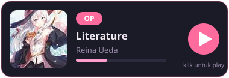</a>
  <a href="https://www.youtube.com/watch?v=KJYdOh0_Jbo">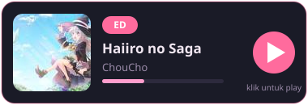</a>

<b>♡ About Me ♡</b>

Wibu garis keras — waifu <b>Elaina</b> <i>(Majo no Tabitabi)</i> 
Ngoprek <b>bot WhatsApp & Telegram</b> · Bikin game seru-seruan 
<i>⋆ akurat, work, no bug ⋆</i>

  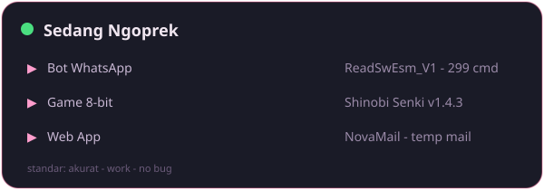

<b>✦ Skills</b>

  

<b>◈ Pinned Projects</b>

  
  

  
  

  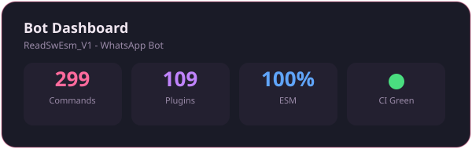

  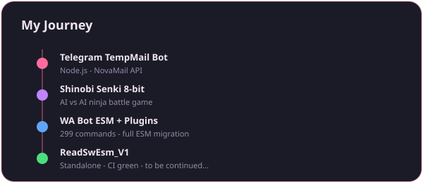

<b>◈ GitHub Stats</b>

  
  

  

<b>◈ Contribution Snake</b>

<picture>
  <source media="(prefers-color-scheme: dark)" srcset="assets/github-snake-dark.svg"/>
  <source media="(prefers-color-scheme: light)" srcset="assets/github-snake.svg"/>
  
</picture>

<b>◈ 3D Contribution Graph</b>

  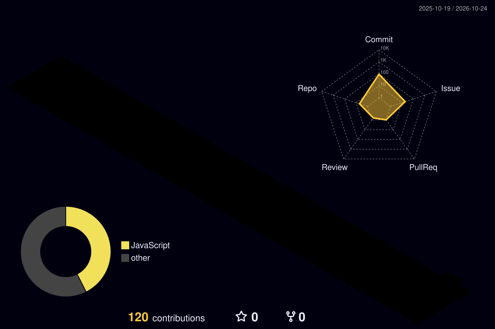

<b>◈ Elaina Gallery HD — klik untuk buka!</b>

 

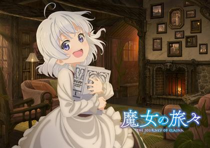 
<i>Elaina baca buku di depan perapian — cozy dan tenang</i>

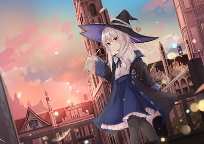 
<i>Terbang dengan sapu di langit cerah — ikonik!</i>

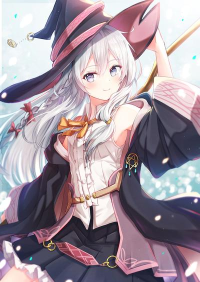 
<i>Senyum manis di bawah langit malam berbintang</i>

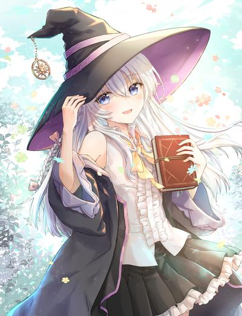 
<i>Menatap langit dengan tatapan teduh</i>

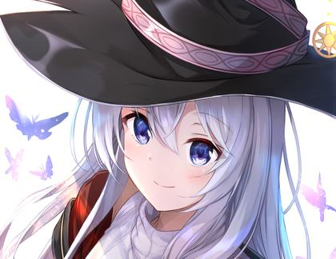 
<i>Payung merah di tengah daun gugur musim autumn</i>

 
<i>Anggun dengan syal merah favoritnya</i>

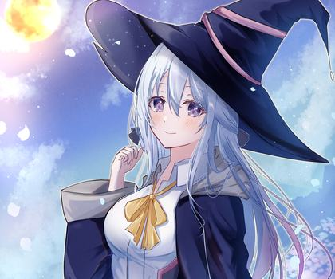 
<i>Berpose megah dengan latar kastil</i>

 
<i>Maid Elaina menikmati teh — versi 4K!</i>

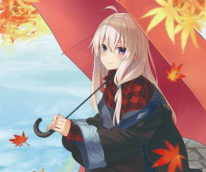 
<i>Di antara bunga-bunga saat matahari senja</i>

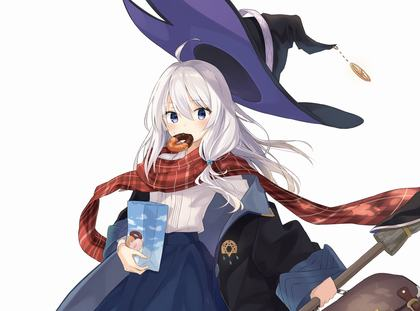 
<i>Menikmati senja di kota fantasi</i>

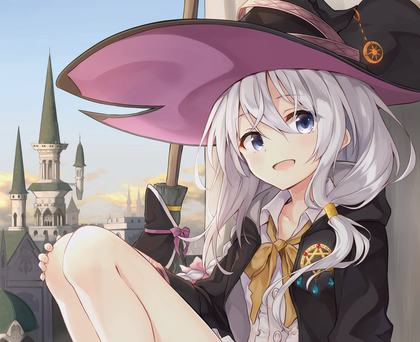 
<i>Close-up senyuman lembutnya</i>

 
<i>Santai di kafe — versi 4K!</i>

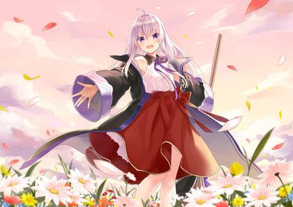 
<i>Dikelilingi kupu-kupu dengan senyum memikat</i>

<b>◈ Fun Facts — klik untuk buka!</b>

 

- Night owl — ide terbaik datang tengah malam
- Ditemani mie + musik pas ngoding
- Gamer sekaligus game maker
- Pemburu bug — standar: <i>no bug</i>
- Elaina is my waifu, no debate

<b>◈ Tools & Environment — klik untuk buka!</b>

 

- Replit & VS Code
- Linux enjoyer
- Android modder
- Bot 24/7 di Pterodactyl / panel

<b>◈ Waifu Card</b>

  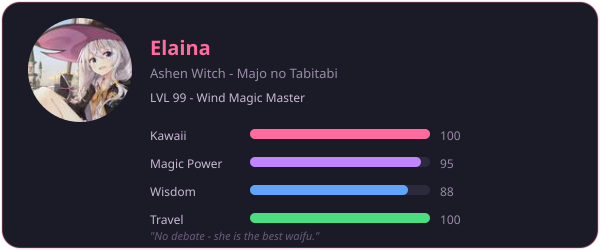

  <i>⋆｡‧˚ʚ♡ɞ˚‧｡⋆ thanks for visiting ⋆｡‧˚ʚ♡ɞ˚‧｡⋆</i>

